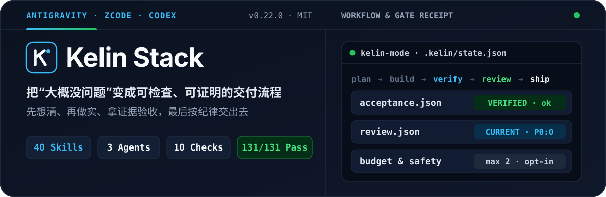
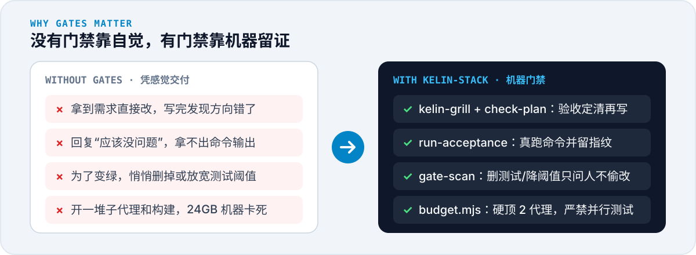
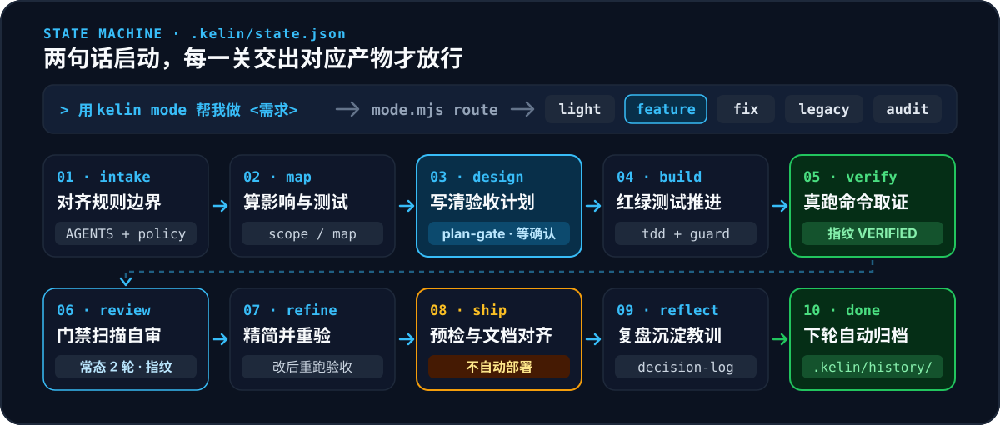

<p align="center">
  
</p>

<p align="center">
  <strong>给 AI 编程代理装上工程门禁：想清楚、先测试、拿证据验收、自审留指纹，再交出去。</strong><br>
  一套 <code>skills/</code> + <code>agents/</code> + <code>hooks/</code> 源码，同时支持 Antigravity 原生插件、ZCode 插件市场与 Codex。
</p>

<p align="center">
  <a href="#按宿主安装">快速安装</a> ·
  <a href="#日常只记两句话">两句话启动</a> ·
  <a href="#七道硬机制">硬机制</a> ·
  <a href="#40-个命令全景">40 个命令</a> ·
  <a href="./docs/support-matrix.md">跨宿主矩阵</a> ·
  <a href="#开发与自检">开发与自检</a>
</p>

```sh
# 最短体验路径（Antigravity 用户级原生插件）
git clone https://github.com/kelinpan0524-cell/kelin-stack.git && cd kelin-stack
./install.sh --host antigravity --scope user
```

装好后在任何项目里只需说两句话：**`kelin mode setup`**（先体检再接入）和 **`用 kelin mode 帮我做 <需求>`**。

---

<p align="center">
  
</p>

AI 写代码最常出事的地方不在语法，而在流程跳步：没想清需求就开工、没跑命令就说“应该没问题”、为了让测试变绿悄悄删掉断言、或者同时开四五个代理把 24GB 内存拖进 swap。

**Kelin Stack 把“把活干扎实”拆成可运行的脚本和阶段门禁**：过不了脚本校验，状态机就不会放行到下一关。

<p align="center">
  
</p>

### 真实运行输出（不是口头承诺）

调用路由时，`/kelin-mode` 先判断任务模式、配套 skill 和环境缺口；交付前，`health.mjs` 一次跑完 7 类离线检查（本仓当前实测 `131/131` 单测通过）：

```json
$ node skills/kelin-mode/scripts/mode.mjs route --task "修复报价提交 500 报错" --root .
{
  "ok": true,
  "mode": "fix",
  "firstPhase": "intake",
  "phases": ["intake", "map", "design", "build", "verify", "review", "refine", "ship", "reflect", "done"],
  "activeSkills": ["kelin-recall", "kelin-agents"],
  "needsGrill": false
}
```

```json
$ node skills/kelin-health/scripts/health.mjs --root .
{
  "ok": true,
  "total": 7,
  "failed": [],
  "checks": [
    { "id": "unit-tests", "ok": true, "summary": "pass 131 / fail 0" },
    { "id": "offline",    "ok": true, "summary": "manifests + 40 skills + 3 agents" },
    { "id": "skill-eval", "ok": true, "summary": "40 skills, problems: []" },
    { "id": "neat",       "ok": true, "summary": "version 0.22.0, broken links: 0" },
    { "id": "docs",       "ok": true, "summary": "skills: 40, digestBytes: 1073" },
    { "id": "agents",     "ok": true, "summary": "AGENTS.md 38 lines (max 200)" },
    { "id": "guards",     "ok": true, "summary": "3 guards verified" }
  ]
}
```

---

<p align="center">
  
</p>

## 日常只记两句话

安装后，Antigravity 与 ZCode 在新会话会自动注入当前工作区状态与入口（Codex 通过 `ensure-workflow.mjs` 写入 `AGENTS.md` 路由块触发）。不用背 40 个命令名：

1. **新仓库接入**：说 **`kelin mode setup`**（在仓库根运行对应 `node skills/kelin-mode/scripts/mode.mjs setup --root .`；装为插件后由 Agent 自动定位 `$SKILL_DIR` 执行）。先只读预览缺什么（`AGENTS.md`、`.gitignore`、`kelin-policy.json`、本地验证手册、`pre-commit`、内存预算与安全钩子），确认后再加 `--apply` 写入。
2. **直接交办任务**：说 **`用 kelin mode 帮我做 <需求>`**，自动运行 `route` 判定模式并挂载当前阶段配套 skill（模糊需求先触发 `kelin-grill` 问透，前端带上 `kelin-ui`），缺产物就不允许 `advance`。
3. **连续迭代不打架**：上一轮跑到 `done` 后，下一轮直接 `init` 会把旧记录归档到 `.kelin/history/`；没跑完的任务下个会话接续执行。

<p align="center">
  
</p>

### 五种模式按任务复杂度分流

| 模式 | 适用场景 | 阶段链路 | 说明 |
| --- | --- | --- | --- |
| `light` | 单文件、文案、小修 | `intake → design → build → verify → ship → reflect → done` | 轻量三行计划 + 快速验证 |
| `feature` | 加功能、改行为 | 完整 10 阶段 | 跨模块强制设计草图与双镜头 `plan-gate` |
| `fix` | 修 bug、修回归 | 完整 10 阶段 | `build` 阶段联动 `kelin-tdd` + `kelin-guard` 防再犯 |
| `legacy` | 老仓库改造、迁移 | 完整 10 阶段 | `map` 强制 `feature-map.json`，切片推进 |
| `audit` | 只审不改 | `intake → map → audit → reflect → done` | 只读体检并强制输出覆盖声明表 |

阶段判定细节与 `plan`/`refine`/`verify` 三档规则见 [kelin-mode](skills/kelin-mode/SKILL.md)。

## 七道硬机制

| 机制 | 负责脚本 / Skill | 实际拦住什么问题 |
| --- | --- | --- |
| **门禁完整性扫描** | `kelin-review/scripts/gate-scan.mjs` | 扫描 diff 中被删的测试、被放宽的阈值、注释掉的检查与跨行 `try/catch {}`；门禁类发现只问人不自动改 |
| **工作树指纹绑定** | `review-check.mjs` / `run-acceptance.mjs` | 把自审结论与验收输出绑定到工作树指纹；改了文件就标记 `STALE` / `UNVERIFIED`，旧回执作废 |
| **只减不增质量棘轮** | `kelin-guard/scripts/ratchet-check.mjs` | 禁止新增钩子 `console.log`、硬编码单宿主提交前缀或仓库相对路径调用 |
| **运行时安全钩子** | `kelin-safety`（`PreToolUse`） | 默认 `off` 不打扰；设 `KELIN_SAFETY=relaxed` 拦灾难级删库/强推，设 `strict` 拦截冻结范围外写入 |
| **24GB 内存预算** | `kelin-mode/scripts/budget.mjs` | 并发硬顶 2 个子代理（1 写 1 读），禁止并行跑构建与测试，Node 脚本建议配 `--max-old-space-size=2048` |
| **跨 CLI 双模型委托** | `kelin-delegate` | 把审查/挑刺/会诊/实现委托给 `codex` / `agy` / `zcode` 无头会话，读类角色强制只读沙箱 |
| **人话简报与质量面板** | `kelin-brief` / `kelin-health` | 先一句“现在等你什么”再列证据和风险；`health.mjs` 一键跑完 7 项离线体检 |

### 三个专用子代理

- `kelin-reviewer`：只报能复现或指出明确代码路径的问题，每条附带 `文件:行号`、触发条件、后果和最小改法。
- `kelin-verifier`：只认命令退出码、文件与截图证据，拒绝“理论上没问题”。
- `kelin-worker`：按父代理拆好的窄任务执行，开工先读 `kelin-mode` 与 `kelin-principles`，不自行扩范围、不嵌套子代理。

---

<p align="center">
  
</p>

## 按宿主安装

三宿主共用同一套 `skills/`、`agents/` 与钩子脚本。安装器幂等、写入前打印目标清单、不覆盖非 `kelin-*` 内容，`--uninstall` 只清理清单自有条目。各宿主能力边界与实测版本见 [跨宿主支持矩阵](docs/support-matrix.md)。

### Antigravity（原生插件，推荐）

```sh
git clone https://github.com/kelinpan0524-cell/kelin-stack.git && cd kelin-stack

# 完整原生插件装到 ~/.gemini/config/plugins/kelin-stack（自动排除 .git 与 ZCode 专用钩子）
./install.sh --host antigravity --scope user
agy plugin validate ~/.gemini/config/plugins/kelin-stack --strict

# 只装指定子集到 ~/.gemini/config/skills/（省上下文）
./install.sh --host antigravity --scope user --subset "kelin-mode,kelin-plan,kelin-verify,kelin-review"

# 装到单个项目 .agents/skills/，或安全卸载
./install.sh --host antigravity --scope project --path /path/to/your-project
./install.sh --host antigravity --scope user --uninstall
```

也可用 `agy plugin install ./kelin-stack` 直接安装（会把 `.git` 与 ZCode `hooks/hooks.json` 一并拷入缓存）。

### ZCode（插件市场，推荐）

```sh
zcode plugins marketplace add kelinpan0524-cell/kelin-stack
zcode plugins install kelin-stack@kelin-stack-market
```

本地调试可用 `zcode plugins marketplace add ./kelin-stack`（同样会把 `.git` 拷入缓存）。

### Codex（安装脚本）

```sh
git clone https://github.com/kelinpan0524-cell/kelin-stack.git && cd kelin-stack

# 用户级（~/.agents/skills/）或项目级（.agents/skills/）
./install.sh --host codex --scope user
./install.sh --host codex --scope project --path /path/to/your-project

# 可选：把 kelin 路由块幂等写入全局 AGENTS.md（先 --dry-run 预览）
node skills/kelin-agents/scripts/ensure-workflow.mjs --global codex --dry-run

# 卸载（只删安装器记录的 kelin-* 条目）
./install.sh --host codex --scope user --uninstall
```

装完重启 ZCode（Antigravity 下轮热加载生效），输入 `kelin-plan` 或 `/kelin-plan` 即可调用。

<details>
<summary>给 WorkBuddy 用（手动复制 skill 目录）</summary>

- **纯指令类 skill**（`plan`、`review`、`principles` 等）：将 `skills/<名字>/` 复制到 `~/.workbuddy/skills/` 或项目 `.workbuddy/skills/`。
- **带脚本的 skill**（`map`、`verify`、`agents`、`guard`、`ci` 等）：脚本使用零依赖 Node，且通过 `$SKILL_DIR` 自定位。
- **插件清单**：仓内已提供 `.zcode-plugin` / `.claude-plugin` / `.cursor-plugin` / `.antigravity-plugin` 四份清单，如需补充 WorkBuddy 清单可提供对应字段。
- 注意：`kelin-verify-stack`（含 `verify-stack run --all`）依赖 ZCode CLI；无 ZCode 环境可跑 `offline-check.mjs` 与 `node --test`，Antigravity 环境另跑 `agy plugin validate`。

</details>

---

## 40 个命令全景

命令统一带 `kelin-` 前缀，避免与宿主内置命令重名。完整字段与脚本/live 索引见自动生成文档 [docs/skills.md](docs/skills.md)。

| 阶段 | 命令列表 | 各自负责什么 |
| --- | --- | --- |
| **想清楚（10）** | `kelin-mode`、`kelin-goal`、`kelin-product`、`kelin-grill`、`kelin-plan`、`kelin-blast-radius`、`kelin-map`、`kelin-legacy`、`kelin-multirepo`、`kelin-ci` | 自动编排与路由；先写目标契约与 PRD 底线；用设计树逐层拷问需求（`grill`）；跨模块设计草图与门禁；改动影响面；路径到功能映射；老仓切片改造与多仓契约；一键接进 CI 与 pre-commit |
| **做扎实（8）** | `kelin-tdd`、`kelin-correctness`、`kelin-verify`、`kelin-loop`、`kelin-refine`、`kelin-guard`、`kelin-safety`、`kelin-test-audit` | 先红后绿 TDD；行为与边界矩阵证明；跑命令出带指纹回执；有上限的自动迭代；按必要性删多余代码；bug 变防再犯检查与棘轮；高危操作拦截；清理假通过和快照水测试 |
| **交出去（10）** | `kelin-review`、`kelin-delegate`、`kelin-audit`、`kelin-ui`、`kelin-unslop`、`kelin-brief`、`kelin-ship`、`kelin-release`、`kelin-watch`、`kelin-decision-log` | 带指纹分级自审；跨 CLI 只读/实现委托；全仓只读体检与覆盖声明；渲染界面检查；文字去 AI 味；人话状态简报；分支交付预检；发版计划与闸门；CI 失败分类盯梢；关键决策日志 |
| **接得住（6）** | `kelin-recall`、`kelin-branches`、`kelin-agents`、`kelin-neat`、`kelin-reflect`、`kelin-principles` | 从仓库状态重建现场；分支清理看板（只报不删）；`AGENTS.md` 预算体检；全仓文档口径对齐；事后复盘沉淀；十条操作底线与六条工程原则 |
| **验证自己（6）** | `kelin-evals`、`kelin-docs`、`kelin-verify-stack`、`kelin-verify-app`、`kelin-benchmark`、`kelin-health` | skill 触发与结构 eval；生成索引与漂移检查；开真实无头会话验插件；生成项目本地 `verify-*` 验收手册；5 轮性能取证；一键跑完 7 项离线健康检查 |

---

## 行为验证器与安全边界

`/kelin-verify-stack` 改自 [open-pstack](https://github.com/ericlitman/open-pstack) 的“证据优先”思路，换成 ZCode 原生实现：

1. **体检**：检查 ZCode CLI、清单、凭据键名（不读值）和全新输出目录；
2. **分类**：按改动路径算出需要跑哪些功能，未知路径直接拒跑；
3. **真跑**：启动无头 `zcode -p` 会话，从模型调用日志核实 `Skill` 确实被调用；
4. **断言与回执**：检查文件里的随机标记与正文原句，汇总 transcript 哈希、产物哈希与前后一致的插件树哈希。

```sh
# 静态全检（0 token，每次改完跑）
node skills/kelin-verify-stack/scripts/verify-stack.mjs run --all --output /tmp/ks-static

# 真实无头会话检查（显式加 --live 才花 token）
node skills/kelin-verify-stack/scripts/verify-stack.mjs run --all --live --output /tmp/ks-live
```

### Token 预算与运行边界

| 动作 | 参考消耗 | 适用时机 |
| --- | --- | --- |
| `run --all`（静态） / `smoke` | 0 | 每次改动与日常提交 |
| 单个 live 功能 | 约 42 万 tokens（多命中缓存，10-20 秒） | 只改单个 skill 后定向复核 |
| `run --all --live`（18 个 live 配方） | 按单个约 42 万 tokens 估算，串行执行（历史 10 个配方实测约 420 万 tokens、3 分钟） | 发版前、大改多个 skill 后 |
| 单个子代理 | 10 万级上下文（最多 2 个） | 明确窄任务，小改用 `kelin-mode light` |

**安全与刻意不做**：

- 仓库不含凭据、客户业务表与联网上报代码；`preflight.mjs` 在提交前拦 `.xlsx`/`.env`/私钥与常见密钥特征。
- 唯一会对外写入的 `verify-stack publish`（发 PR 评论与 commit status）必须显式传 `--confirm`，`run` 不会自动触发。
- `kelin-delegate` 发送给外部 CLI 的提示词和文件会经过对应模型服务商，切勿放密钥或客户数据。
- **自动开 PR、自动部署仍不做**；合并不再一律手动，走 `kelin-ship` 的自动合并门（六条全满足才可合并，触发部署的仓库仍需明确部署授权）。

---

## 开发与自检

<details>
<summary>本地全套检查命令（CI 同款 10 项检查 + 双宿主冒烟）</summary>

```sh
node skills/kelin-health/scripts/health.mjs --root .
node --test $(find skills -name '*.test.mjs' | sort | tr '\n' ' ')
node skills/kelin-verify-stack/scripts/offline-check.mjs
node skills/kelin-agents/scripts/agents-check.mjs AGENTS.md
node skills/kelin-guard/scripts/guard-check.mjs guards.json
node skills/kelin-guard/scripts/ratchet-check.mjs ratchet.json --strict-shrink
node skills/kelin-neat/scripts/neat-check.mjs neat.json
node skills/kelin-evals/scripts/skill-eval.mjs --root .
node skills/kelin-evals/scripts/skill-bill.mjs --root .
node skills/kelin-evals/scripts/drift-check.mjs --root .
node skills/kelin-docs/scripts/gen-docs.mjs --check
node skills/kelin-docs/scripts/doc-coverage.mjs --root . --check
node skills/kelin-mode/scripts/policy-check.mjs kelin-policy.json
node skills/kelin-verify-stack/scripts/verify-stack.mjs smoke --host antigravity
node skills/kelin-verify-stack/scripts/verify-stack.mjs smoke --host codex
agy plugin validate .
```

按改动路径定向验证 skill：

```sh
node skills/kelin-verify-stack/scripts/verify-stack.mjs classify --changed skills/kelin-plan/SKILL.md
node skills/kelin-verify-stack/scripts/verify-stack.mjs run --changed skills/kelin-plan/SKILL.md --output /tmp/ks-one
```

</details>

<details>
<summary>与上游 pstack 的设计取舍及仓库目录</summary>

`pstack` 面向 Claude Code / Codex 与 `bun` 环境，直接搬到 ZCode 和 Antigravity 会出现命令重名、钩子协议不兼容与无头接入差异，因此本仓采用原生重写：

| pstack | kelin-stack | 取舍原因 |
| --- | --- | --- |
| 46 个 skill | 40 个 skill | 只保留对应真实工程故障的命令，不凑数 |
| `poteto-mode` | `kelin-mode` | 加入 24GB 内存预算、5 模式路由与老仓库切片 |
| T3 / 宿主外编排 | 不做 | 避免与宿主自身调度冲突；改为 SessionStart 注入 + `kelin-delegate` |
| swarm / arena 多代理 | 最多 2 个（1 写 1 读） | 防止 24GB 本机开 3 个以上会话拖进 swap |
| 20+ 条 `principle-*` | 合并为一页 `kelin-principles` | 十条操作底线 + 六条工程原则能记住也用得上 |

```text
kelin-stack/
├── .antigravity-plugin/ # Antigravity 原生插件清单
├── .zcode-plugin/       # ZCode 插件清单
├── .claude-plugin/      # Claude Code 插件与市场清单
├── .cursor-plugin/      # Cursor 市场清单
├── hooks.json           # Antigravity 根钩子声明（SessionStart + PreToolUse）
├── hooks/               # 跨宿主钩子脚本 + ZCode hooks/hooks.json
├── rules/               # Antigravity 常驻规则（AGENTS.md）
├── assets/              # 插件图标（logo.svg）与 README 视觉资产（assets/readme/）
├── skills/              # 40 个 skill，完整索引见 docs/skills.md
├── agents/              # 3 个子代理：kelin-reviewer / kelin-verifier / kelin-worker
├── evals/               # 触发 eval 与行为 fixture eval
├── install.sh           # antigravity 原生插件 / codex 跨宿主安装器
├── agents-digest/       # 一页速查（给不装插件的 agent）
├── docs/                # 生成的 skill 索引与跨宿主支持矩阵
├── kelin-policy.json    # 自动化边界与预算
├── guards.json          # bug 到防再犯检查记录
├── ratchet.json         # 只减不增质量棘轮基线
├── neat.json            # 文档一致性配置
└── .github/             # CI 门禁
```

</details>

## 许可

MIT。设计灵感来自 pstack（Cursor，MIT）与 open-pstack（Eric Litman，MIT），详见 [NOTICE](NOTICE)。仓内文本、脚本与验证器均为独立中文工程实现，未逐字复制上游源码。
